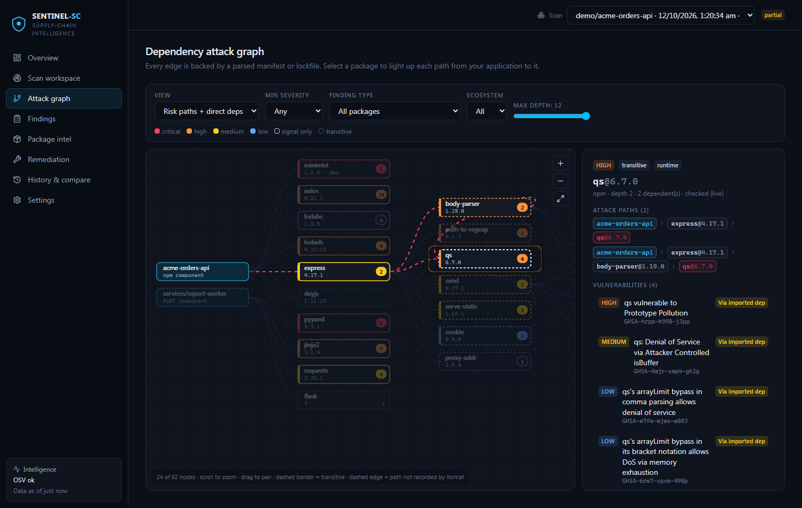

# SENTINEL-SC — Software Supply-Chain Attack Detection & Risk Intelligence

SENTINEL-SC scans a repository's dependency manifests and lockfiles, matches every **exact** dependency
version against public vulnerability intelligence, reconstructs **how each risky package reaches the
application**, looks for **suspicious-package and integrity signals**, explains **every score**, and
proposes **verified, compatibility-checked fixes** — without installing or executing any scanned code.



| Question | How SENTINEL-SC answers it |
|---|---|
| Which dependencies are vulnerable, suspicious, compromised or poorly maintained? | OSV version-specific matching (re-checked by a local range evaluator) + transparent heuristics (typosquat, install scripts, source-pattern inspection, provenance, integrity, release patterns, maintenance) |
| Which direct and transitive dependencies introduce each risk? | Graph reconstructed from lockfiles; every finding carries all application → … → package paths and a blast radius |
| How can it affect the application? | Static reachability: advisory-named symbol called at a specific line / imported / reached via an imported dependency / not imported / unknown |
| Is the vulnerable code reachable, and what supports that? | Each level shows file:line evidence and states what further evidence is needed for exploitability. Installed ≠ reachable. |
| Which upgrade is safest and most compatible? | Smallest version fixing all advisories, **re-queried on OSV** ("fix verified"), checked against declared ranges and parent ranges; transitive fixes resolved through registry dependency ranges along every path |
| Can I trust where a package came from? | **Cryptographic provenance verification** (Sigstore): proves "this exact tarball was built from repo X at commit Y by workflow Z", checked against the hash in your lockfile |
| What would prevent it next time? | Deterministic policy gate (CLI exit codes, JSON), **pull-request dependency review** that comments on every PR with only the risk it adds, CycloneDX SBOM + VEX, risk-regression comparison |

> **Honesty rules built into the engine:** a provider failure is shown as *Not verified*, never as clean;
> heuristics are labelled as signals, never as confirmed malware; unknown inputs stay unknown in scores;
> simulations are labelled *SIMULATED*; patches are previews and are never applied.

## New in this version

| Feature | In plain words | Where |
|---|---|---|
| **Scan from a GitHub URL** | Paste `https://github.com/owner/repo` (optionally a branch, tag or commit). SENTINEL-SC finds the exact commit, downloads that snapshot safely and scans it. Nothing is cloned or run, and the commit ID is recorded so the result can be reproduced. | Scan workspace, `python -m sentinel scan https://github.com/owner/repo` |
| **Pull-request dependency review** | Compares the main branch with a pull request and reports only what the PR *adds*: new packages, version changes (downgrades are flagged), new vulnerabilities, typosquats, install scripts. Fails the check if the PR adds serious risk, and posts a readable comment on the PR. Old problems already on main don't block the PR. | `.github/workflows/sentinel-pr-review.yml`, `python -m sentinel review`, History page, **Run PR-review demo** button |
| **Multi-agent orchestration** | The scan is run by an **Orchestrator** and five specialist agents: Vulnerability Intelligence and Package Trust work **in parallel**, then Reachability Analysis, Remediation, and an **Independent Security Reviewer** that checks every claim against its evidence and downgrades anything unsupported (e.g. a "verified fix" that was never re-checked). All facts come from deterministic tools; optional AI (Claude, off by default) only explains, and a guard rejects AI text that contradicts the verdict. | **Agents** page, reviewer status on each finding |
| **Verified build provenance** | Many npm packages now publish a signed statement saying where they were built. SENTINEL-SC checks that signature with Sigstore, confirms it was issued to GitHub Actions for the same repo and commit, confirms it is in the public transparency log, and confirms it is about the exact file in your lockfile. A broken or mismatched one is flagged (and fails the gate). | Package intel → "Build provenance", Overview |

## Quick start

Requirements: Python 3.11+ (3.12 tested), Node 18+ (24 tested). No API keys, no paid services.

```powershell
./scripts/start.ps1          # Windows
```
```sh
./scripts/start.sh           # macOS / Linux
```
Open **http://127.0.0.1:8000** → **Scan workspace → Scan demo project**.

Manual setup:
```sh
cd backend
python -m venv .venv && .venv/Scripts/activate      # .venv/bin/activate on macOS/Linux
pip install -r requirements-dev.txt
cd ../frontend && npm ci && npm run build && cd ../backend
python -m uvicorn sentinel.app:app --host 127.0.0.1 --port 8000
```
UI development with hot reload: `cd frontend && npm run dev` (Vite on :5173, proxies `/api` to :8000).

### CLI / CI security gate
```sh
cd backend
python -m sentinel scan <directory | repo.zip | lockfile | bom.cdx.json> \
    [--offline] [--policy ../.sentinel-policy.example.json] \
    [--json out.json] [--html out.html] [--sbom out.cdx.json] [--strict-warn]
```
Exit codes: `0` pass/warn · `1` policy violation · `2` scan error · `3` warnings with `--strict-warn`.
Scan a public GitHub repository directly: `python -m sentinel scan https://github.com/owner/repo[/tree/<branch-or-tag>]`.

Pull-request review (compare two versions, gate only on newly introduced risk):
```sh
python -m sentinel review --base <main dir|zip|GitHub URL> --head <PR dir|zip|GitHub URL> --markdown review.md
```
The review uses a stricter default for *new* risk: it fails on new high/critical vulnerabilities and corroborated
typosquats (override with `--policy`). Workflow: [.github/workflows/sentinel-pr-review.yml](.github/workflows/sentinel-pr-review.yml)
— it runs the scanner from the trusted base branch (never the PR's copy) and posts/updates one PR comment.

Reusable GitHub Actions gate workflow: [.github/workflows/sentinel-gate.yml](.github/workflows/sentinel-gate.yml)
(read-only token, actions pinned to commit SHAs verified against GitHub).

### Offline / degraded network
`--offline` (CLI) or **Settings → Privacy → Offline mode** uses only cached data and the versioned snapshot
[demo/fixtures/intel-snapshot.json](demo/fixtures/intel-snapshot.json) (retrieved live on 2026-10-15). Every fact
is labelled `live`, `cache`, `stale` or `fixture` with its retrieval time. Regenerate: `python backend/scripts/snapshot_intel.py`.

## What the demo shows

[demo/demo-app](demo/demo-app) is a realistic Express + Python service with **real packages pinned to real
vulnerable versions** (lockfile generated with `npm install --package-lock-only --ignore-scripts`; nothing was installed or run).

| Scenario | Evidence SENTINEL-SC produces |
|---|---|
| Direct vulnerability with call site | `lodash@4.17.15` — GHSA-35jh-r3h4-6jhm (CVE-2021-23337, merged with aliased GHSA-r5fr-rjxr-66jc); `src/server.js:16` calls `_.template` → *static call-site evidence* |
| Transitive vulnerability | `qs@6.7.0` via `acme-orders-api → express@4.17.1 → qs` **and** `→ express → body-parser@1.19.0 → qs` |
| Second ecosystem | `PyYAML 5.3.1` (GHSA-8q59-q68h-6hv4 / CVE-2020-14343); `worker.py:8` calls `yaml.full_load` |
| Exposure-aware priority | `minimist@1.2.5` is **critical** but a never-imported dev dependency → priority P4 |
| Not-vulnerable control | `dayjs` resolves to a current release: checked, zero advisories |
| Honest unknown | `flask>=2.0` has no exact version → *Not verified*, never "clean" |
| Suspicious package (SYNTHETIC, labelled, inert) | `lodahs` (typosquat of lodash), `file:` dependency with `postinstall`; source inspection finds `eval`, base64 decoding (decoded statically to `console.log("demo")`), `process.env` serialisation, HTTPS request to a `.invalid` host |
| CI/CD risks | `pull_request_target` + PR-head checkout, `write-all`, unpinned third-party action, `${{ github.event.pull_request.title }}` script injection |
| Secret hygiene | AWS's documented example key → detected, redacted, low confidence |
| Remediation | One manifest patch: express 4.17.1 → 4.22.3 resolves qs, body-parser, path-to-regexp, send, serve-static and cookie through express's own ranges; every target re-checked on OSV; what-if 50 → 0 known advisories (simulated) |

Expected findings: [demo/fixtures/expected-findings.json](demo/fixtures/expected-findings.json) (asserted by tests).
Reset: **Settings → Privacy → Reset demo dataset**. Judging walkthrough: [docs/DEMO_SCRIPT.md](docs/DEMO_SCRIPT.md).

Sample outputs from a real live scan: [JSON](docs/samples/demo-report.json) · [HTML](docs/samples/demo-report.html) ·
[CycloneDX SBOM + VEX](docs/samples/demo-sbom.cdx.json) · [gate](docs/samples/demo-gate.json) · [patch](docs/samples/demo-remediation.diff).

## Product tour

| Page | Purpose |
|---|---|
| **Overview** | Posture, verified severity split, confirmed vs suspicious, ecosystem exposure, reachability mix, top priorities, trend, provider freshness, coverage |
| **Scan workspace** | One-click demo, **PR-review demo**, **scan a public GitHub URL**, drag-and-drop upload (zip / lockfile / SBOM), offline toggle, live stage progress with cancel, partial/failed states |
| **Attack graph** | Layered dependency graph; select a node to animate every path from the application; filters; evidence + fix side panel |
| **Findings** | Server-side search/filter/sort/pagination; drawer with advisory, range check, all paths, reachability evidence, **Why this score?**, fix, evidence ledger; CSV/JSON/SBOM export |
| **Package intel** | Registry history, trust profile (integrity, **Sigstore-verified provenance** with commit/workflow/transparency-log links, signatures, maintenance, Scorecard, install scripts), explicit uncertainty |
| **Agents** | Execution plan, each agent's run and outputs, the reviewer's checks/corrections/conflicts, optional AI explanations, and the inter-agent message trace |
| **Remediation** | Per-package plan with state + fix confidence, compatibility checks, commands, patch preview, combined patch, what-if simulation |
| **History & compare** | Scan history, risk regression (new / resolved / changed findings, dependency version changes) and a **PR-style review** with downloadable PR comment |
| **Settings** | Policy editor + live evaluation, provider health & cache, privacy & retention, ecosystem matrix & limits, scoring model, CI snippet, security events |

## Documentation
- [docs/ARCHITECTURE.md](docs/ARCHITECTURE.md) — components, data flow, pipeline
- [docs/THREAT_MODEL.md](docs/THREAT_MODEL.md) — trust boundaries, attacks, mitigations, residual risk
- [docs/ECOSYSTEMS.md](docs/ECOSYSTEMS.md) — supported files and limitations
- [docs/SCORING.md](docs/SCORING.md) — risk model
- [docs/DEMO_SCRIPT.md](docs/DEMO_SCRIPT.md) — judging walkthrough
- [docs/COMPARISON.md](docs/COMPARISON.md) — beyond a conventional scanner
- [docs/TEST_RESULTS.md](docs/TEST_RESULTS.md) — real test results, including failures found and fixed

## Repository layout
```
backend/sentinel/   engine + API: parsers/ intel/ analyzers/ scoring remediation policy sbom report engine jobs app cli
                    github (URL import) review (PR review) provenance (Sigstore verification)
                    agents/ (orchestrator, vuln_intel, package_trust, reachability, remediation, reviewer, AI assistant)
backend/tests/      functional, adversarial/security and API tests (pytest)
frontend/           React + TypeScript + Vite + Tailwind UI; e2e/demo-flow.mjs browser test
demo/               demo-app (vulnerable fixture project), pr-review/ (base = main, head = risky PR), fixtures/ (intel snapshot, expected findings)
docs/               documentation, samples, screenshots
.github/workflows/  reusable security-gate workflow and pull-request review workflow
```

## Known limitations (summary)
- Transitive paths exist only where a lockfile/SBOM records them; `pom.xml`/Gradle build files are direct-only; `go.mod` indirect modules have unknown parents; requirements.txt edges only from pip-compile annotations.
- Reachability is static import/call-site analysis (JS/TS, Python, Go) — no data-flow/taint analysis. A call site shows vulnerable code *can* run, not that it is exploitable.
- Advisory-text symbol extraction is heuristic (OSV structured symbols used when present, mainly Go).
- Provenance verification covers npm packages built on GitHub Actions (SLSA v1 + Sigstore); other ecosystems/CI systems are reported as present/absent or unsupported. Up to 60 verifications per scan.
- GitHub URL scanning supports public github.com repositories only (no tokens; GitHub allows 60 anonymous lookups/hour); not available offline.
- PR review compares two scans; it does not re-resolve dependencies itself, so both sides need lockfiles for exact results.
- Registry metadata only for npm and PyPI (≤120 packages per scan).
- What-if re-evaluates changed packages only; their own transitive dependencies are not re-resolved.
- AI explanations (optional) need an Anthropic API key (`ANTHROPIC_API_KEY`) and cost money per scan (shown in the UI); in this build they were tested with a stand-in client only, not against the live API.
- Single-user local tool: no authentication; binds to 127.0.0.1 and must not be exposed to a network as-is.
