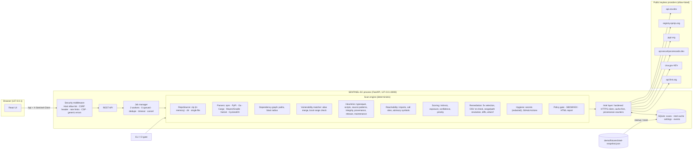

# Architecture

## Components



## Scan pipeline (the stages shown live in the UI)

| # | Stage | What happens | Data sent |
|---|---|---|---|
| 1 | Reading input safely | Archive indexed in memory; unsafe entries rejected and reported | — |
| 2 | Parsing manifests and lockfiles | Ecosystem detection, manifest↔lockfile pairing, per-file outcome (parsed/partial/unsupported/error) | — |
| 3 | Reconstructing dependency graph | Edges only where the format records them, `unknown-path` otherwise | — |
| 4 | Matching versions against OSV | `querybatch` (≤500/request) for exact versions; cached 6 h | name + version |
| 5 | Retrieving advisory records | `/v1/vulns/{id}`, 8 threads; withdrawn dropped; aliases merged | advisory IDs |
| 6 | Registry metadata, provenance, trust | npm/PyPI docs reduced to used fields; Scorecard for direct deps | names, repo paths |
| 7 | Heuristics and source inspection | Per-package and repository-level signals | — |
| 8 | Static import and call-site analysis | JS/TS/Python/Go import index; advisory symbols matched at call sites | — |
| 9 | Exploitation evidence | CISA KEV catalogue, FIRST EPSS | CVE IDs |
| 10 | Planning and verifying fixes | Target selection, OSV re-query, range checks, path resolution via registry ranges, diffs | names + candidate versions |
| 11 | Secret and CI/CD checks | Redacted secret patterns, GitHub Actions analysis | — |
| 12 | Scoring, policy, report | Four scores + factors, deterministic gate, summary | — |

Progress is weighted per stage and advances with completed work inside a stage (versions queried, advisories
fetched, packages planned).

## Data model (abridged)
```
Package  id="npm:qs@6.7.0", ecosystem, name, version (exact or null), version_exact, direct, scope,
         integrity, resolved, source_type, has_install_script, declared_spec, local_path
Finding  id (version-specific), fingerprint (version-independent, for regression diffs),
         kind = vulnerability|suspicious|integrity|maintenance|hygiene|secret|ci, severity, confidence, verified,
         advisory{…}, evidence[] (ledger), paths[][], blast_radius, reachability{level,label,explanation,evidence,needed},
         exploitation{kev,epss}, remediation{state,target,fix_confidence}, scores{intrinsic,exposure,confidence,priority,factors[]}
Plan     installed → target, state, fix_confidence, candidates_checked[], compatibility[], actions[],
         resolution_upgrades[], paths, patch{diff}, alternatives
```

## Intelligence provenance
`IntelContext.lookup` returns `(value, origin, fetched_at)`: `live`, `cache` (fresh), `stale` (TTL expired, used
because the live call failed), `fixture` (versioned snapshot; offline or fallback), or `unavailable`. Per-provider
counters are stored with every result. A package whose OSV lookup is unavailable is **Not verified** and, by default,
fails the policy gate.

## Privacy
Only package identifiers, CVE IDs and public repository paths leave the machine. Source, file contents, secrets,
environment variables, local paths and repository names never do. Uploads live in memory for the scan only; results
are stored in local SQLite with configurable retention (default 30 days) and can be purged from the UI.

## Limits and scalability
- ≤2 concurrent scans, ≤6 queued, duplicates de-duplicated while running, 10-minute timeout.
- Upload ≤50 MB; ≤50 000 entries; ≤200 MB read; ≤8 MB/file; depth ≤40; compression ratio ≤200:1.
- Graph ≤20 000 packages; reachability ≤4 000 files × 512 KB; registry metadata ≤120 packages/scan.
- Demo scan: ~13 s cold (live, ~150 HTTP calls), ~3 s warm cache, <2 s offline.
- The UI graph shows ≤1 500 nodes (risk-focused view by default); findings are paginated server-side.
