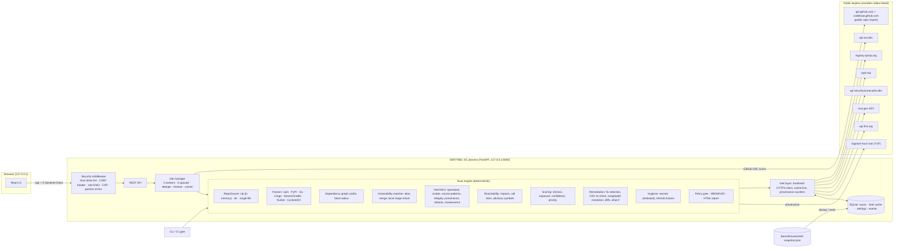
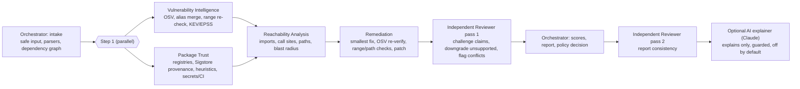

# Architecture

## Components



## Multi-agent orchestration



- **Shared evidence board** (`agents/base.py:Board`): each agent writes only its own section; the orchestrator assembles the report.
- **Facts are deterministic.** Agents 2-5 use parsers, OSV, registries, Sigstore and static analysis only.
- **The reviewer can only make the report more conservative.** Pass-1 checks run before scoring, so scores reflect corrections:
  a verified vulnerability needs an advisory record, an exact version and an agreeing range; "clean" needs real intelligence;
  "fix verified" needs an OSV re-check with zero advisories; "safe candidate" may not cross a breaking boundary or leave
  advisories; "call-site evidence" needs a file and line; heuristics are never "verified"; verified provenance needs repo,
  commit and log entry. Conflicts flagged: provenance vs typosquat, provenance vs integrity mismatch, OSV vs local range,
  a fix that resolves to a still-vulnerable version. Pass 2 checks score bounds and explanations, evidence on every finding,
  summary counts, and that the policy verdict is reproducible. Verdict: `approved` | `approved_with_corrections` | `rejected`.
- **Optional AI** (`agents/assistant.py`, `claude-opus-5-5`, adaptive thinking, structured JSON output, server-side refusal
  fallbacks): receives only the top findings' evidence (no secrets; code lines only if you opt in) and returns explanations
  and investigation steps. A deterministic guard drops anything that cites unknown findings or claims something is safe or a
  false positive. Stored separately (`result.ai`, `finding.ai_explanation`); never affects findings, scores or the verdict.
- **Trace:** `result.orchestration` holds the plan, every agent run (status, duration, outputs) and inter-agent messages;
  `result.review` holds the reviewer's checks, corrections and conflicts. Shown on the **Agents** page.

## Scan pipeline (the stages shown live in the UI)

| # | Stage (agent) | What happens | Data sent |
|---|---|---|---|
| 1 | Reading input safely | Archive indexed in memory; unsafe entries rejected and reported | — |
| 2 | Parsing manifests and lockfiles | Ecosystem detection, manifest↔lockfile pairing, per-file outcome (parsed/partial/unsupported/error) | — |
| 3 | Reconstructing dependency graph | Edges only where the format records them, `unknown-path` otherwise | — |
| 4 | Matching versions against OSV | `querybatch` (≤500/request) for exact versions; cached 6 h | name + version |
| 5 | Retrieving advisory records | `/v1/vulns/{id}`, 8 threads; withdrawn dropped; aliases merged | advisory IDs |
| 6 | Registry metadata, provenance, trust | npm/PyPI docs reduced to used fields; Scorecard for direct deps | names, repo paths |
| 6b | Verifying build provenance (Sigstore) | For npm versions that publish SLSA provenance: fetch the attestation, verify signature + certificate identity + transparency-log proof with sigstore-python, bind to the lockfile SHA-512, compare repo with registry metadata (≤60/scan) | names + versions; Sigstore trust-root refresh |
| 7 | Heuristics and source inspection | Per-package and repository-level signals | — |
| 8 | Static import and call-site analysis | JS/TS/Python/Go import index; advisory symbols matched at call sites | — |
| 9 | Exploitation evidence | CISA KEV catalogue, FIRST EPSS | CVE IDs |
| 10 | Planning and verifying fixes | Target selection, OSV re-query, range checks, path resolution via registry ranges, diffs | names + candidate versions |
| 11 | Secret and CI/CD checks | Redacted secret patterns, GitHub Actions analysis | — |
| 11b | Independent review (pass 1) | Reviewer agent challenges every claim and downgrades unsupported ones before scoring | — |
| 12 | Scoring, policy, report | Four scores + factors, deterministic gate, summary | — |
| 13 | Independent review (pass 2) + optional AI explanations | Report consistency checks; if enabled, Claude explains the top findings (guarded, never decisive) | AI only: top-finding evidence, opt-in |

Progress is weighted per stage and advances with completed work inside a stage (versions queried, advisories
fetched, packages planned).

## Data model (abridged)
```
Package  id="npm:qs@6.7.0", ecosystem, name, version (exact or null), version_exact, direct, scope,
         integrity, resolved, source_type, has_install_script, declared_spec, local_path
Finding  id (version-specific), fingerprint (version-independent, for regression diffs),
         kind = vulnerability|suspicious|integrity|maintenance|hygiene|secret|ci, severity, confidence, verified,
         advisory{…}, evidence[] (ledger), paths[][], blast_radius, reachability{level,label,explanation,evidence,needed},
         exploitation{kev,epss}, remediation{state,target,fix_confidence}, scores{intrinsic,exposure,confidence,priority,factors[]}
Plan     installed → target, state, fix_confidence, candidates_checked[], compatibility[], actions[],
         resolution_upgrades[], paths, patch{diff}, alternatives
```

## Scan from a GitHub URL

```
user text ──► parse_github_url ──► (owner, repo, ref)   only github.com accepted; strict character rules
                                       │                 the user's URL is never fetched
                                       ▼
api.github.com/repos/{o}/{r}           default branch, private? size sanity check
api.github.com/repos/{o}/{r}/commits/{ref}   ──► exact commit SHA (recorded in the result)
                                       ▼
codeload.github.com/{o}/{r}/zip/{sha}  hardened client: HTTPS, allow-list, every redirect re-checked,
                                       streamed with a 50 MB cap
                                       ▼
ZipSource (in memory) ──► normal multi-agent scan
```
Runs inside the job worker (progress shows "Fetching source"); disabled in offline mode. Result field
`scan.source` holds repository, requested/resolved ref, commit SHA and commit URL.

## Pull-request dependency review

```
base scan (main) ─┐
                  ├─► review.review(): package set diff (added / removed / upgrade / downgrade),
head scan (PR)  ──┘   finding diff by version-independent fingerprint (new / resolved),
                      "needs a human look" (install scripts, non-registry sources, downgrades,
                      typosquats, dependency growth, unverified new packages)
                  ──► policy on NEW findings only (stricter review default: high+ vulns, typosquat,
                      provenance_invalid) ──► verdict + compact Markdown PR comment + JSON
```
Entry points: `python -m sentinel review`, `GET /api/compare/{base}/{head}/review`, History page, and
`.github/workflows/sentinel-pr-review.yml` (scanner from the trusted base ref; comment via `gh` with env-only values).

## Build provenance verification

```
npm registry /-/npm/v1/attestations/{name}@{version}  ──► SLSA v1 attestation (Sigstore bundle)
sigstore-python Verifier.verify_dsse(bundle, policy)
   policy = OIDC issuer is GitHub Actions  AND  certificate source repo == attested repo
                                           AND  certificate source commit == attested commit
   checks = DSSE signature · Fulcio certificate chain · Rekor inclusion proof / signed timestamp
verified statement subject == pkg:npm/{name}@{version}  AND  sha512 == lockfile integrity
attested repo vs registry "repository" field  ──► verified | repo_mismatch | invalid | absent | unsupported | unavailable
```
The trust root is refreshed via TUF when online and falls back to the root bundled with sigstore-python
(also used offline). `invalid` creates a high-severity integrity finding that fails the default gate.

## Intelligence provenance
`IntelContext.lookup` returns `(value, origin, fetched_at)`: `live`, `cache` (fresh), `stale` (TTL expired, used
because the live call failed), `fixture` (versioned snapshot; offline or fallback), or `unavailable`. Per-provider
counters are stored with every result. A package whose OSV lookup is unavailable is **Not verified** and, by default,
fails the policy gate.

## Privacy
Only package identifiers, CVE IDs and public repository paths leave the machine (plus, when you choose to
scan a GitHub URL, the owner/repo/ref you typed is sent to GitHub to download it). Source, file contents, secrets,
environment variables, local paths and repository names never do. Uploads live in memory for the scan only; results
are stored in local SQLite with configurable retention (default 30 days) and can be purged from the UI.

## Limits and scalability
- ≤2 concurrent scans, ≤6 queued, duplicates de-duplicated while running, 10-minute timeout.
- Upload ≤50 MB; ≤50 000 entries; ≤200 MB read; ≤8 MB/file; depth ≤40; compression ratio ≤200:1.
- Graph ≤20 000 packages; reachability ≤4 000 files × 512 KB; registry metadata ≤120 packages/scan.
- Demo scan: ~13 s cold (live, ~150 HTTP calls), ~3 s warm cache, <2 s offline.
- The UI graph shows ≤1 500 nodes (risk-focused view by default); findings are paginated server-side.
